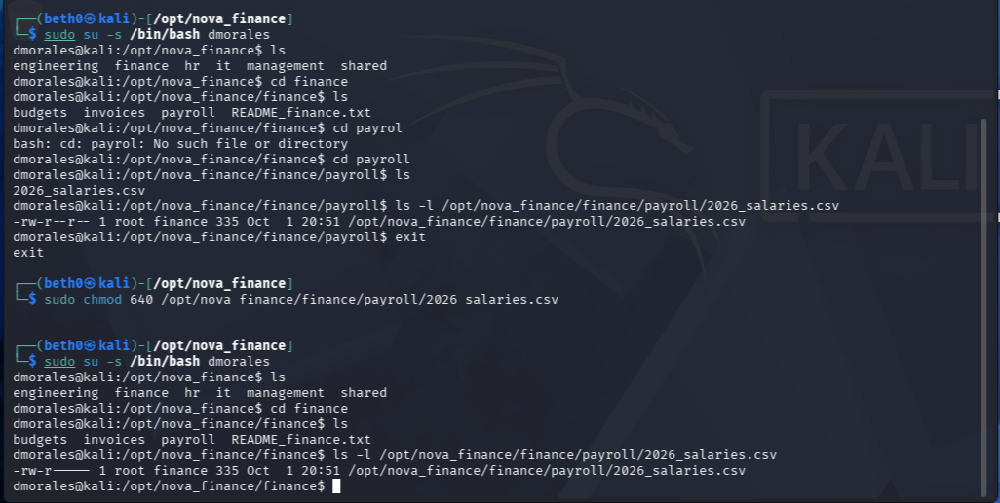
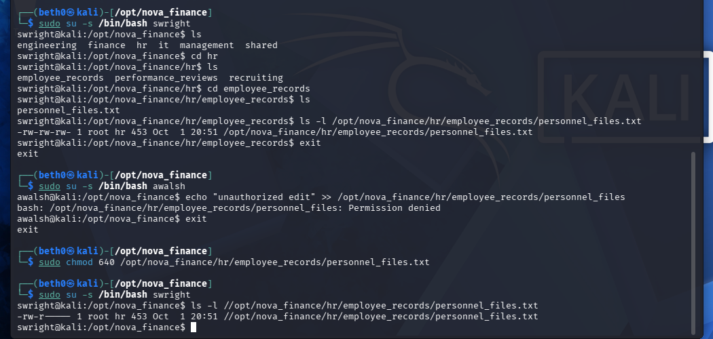
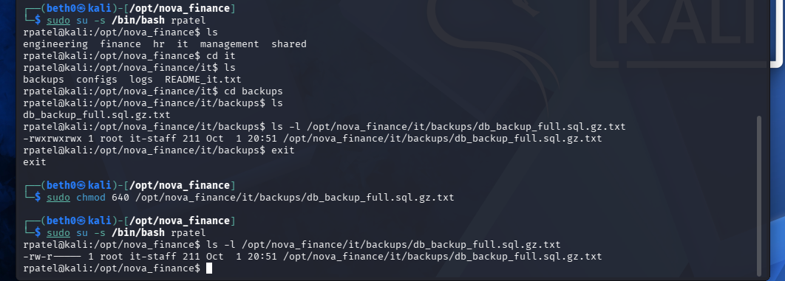
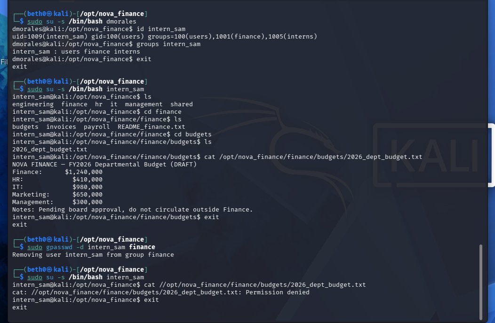
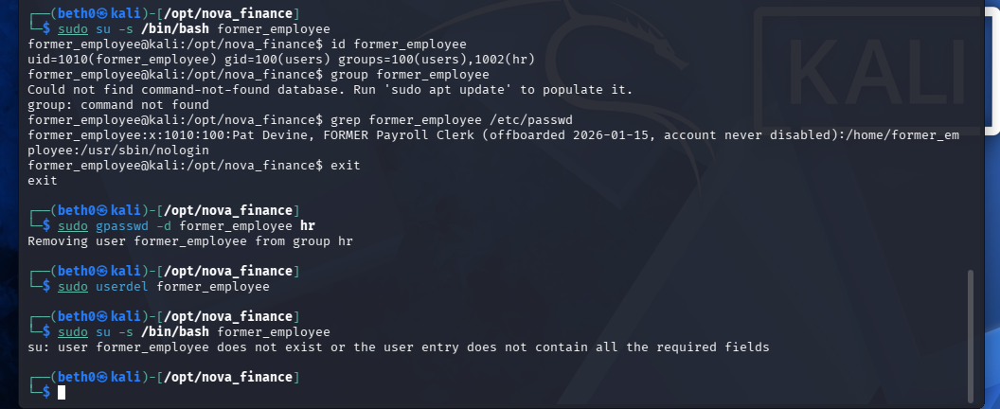
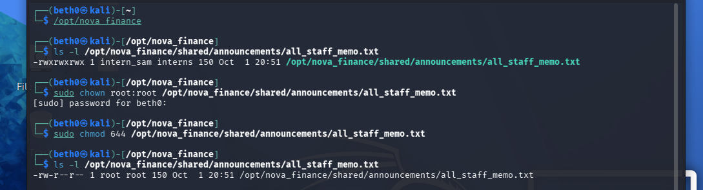
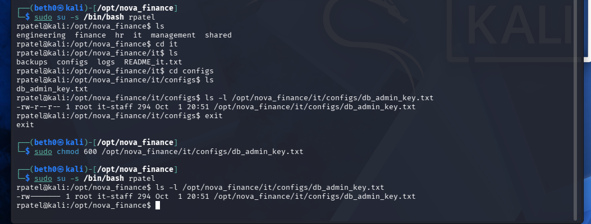

# NOVA FINANCE LINUX PERMISSIONS AND ACCESS CONTROL INVESTIGATION

# Project Overview

NOVA FINANCE is a simulated corporate security environment created to investigate Linux file-permission vulnerabilities, inappropriate user privileges, and access-control weaknesses.
In this hands-on investigation, I assumed the role of a new member of the NOVA FINANCE IT Security team, tasked with investigating seven security tickets and a final payroll data-leak incident.
The exercise involved examining file permissions, ownership, directory access, user accounts, and group memberships to identify security weaknesses and determine their potential impact.

# Objectives:

- Identify insecure Linux file and directory permissions.
- Investigate file ownership and group configurations.
- Detect excessive user privileges and inappropriate group memberships.
- Examine account lifecycle and offboarding weaknesses.
- Assess risks associated with exposed sensitive files.
- Correlate access-control evidence to investigate a simulated payroll leak.
- Recommend appropriate security remediation measures.

# Tools & Technologies

| Tool | Purpose |
|---|---|
| Kali Linux | Investigation environment |
| Bash | Command-line operations |
| ls -l | Inspect file permissions and ownership |
| id | Investigate user identities and group memberships |
| groups | Inspect group memberships |
| find | Search for files with insecure permissions |
| chmod | Modify file permissions |
| chown | Modify file ownership |    

# Practical Implementation

The investigation covered seven security tickets:

# Ticket 1: Payroll File Exposure 
Investigating excessive read permissions on sensitive payroll records.

**Screenshot 1: Payroll File Exposure**

# Ticket 2: HR Personnel File Manipulation 
Examining unauthorized write permissions on confidential employee records.

**Screenshot 2: HR Personnel File Manipulation**

# Ticket 3: Database Backup Exposure 
Assessing insecure permissions on a simulated database backup.

**Screenshot 3: Database Backup Exposure**

# Ticket 4: Excessive Intern Privileges 
Investigating inappropriate Finance group membership.

**Screenshot 4: Excessive Intern Privileges**

# Ticket 5: Former Employee Account 
Examining account status and residual HR group membership.

**Screenshot 5: Former Employee Account**

# Ticket 6: Company-Wide Memo Manipulation 
Investigating incorrect file ownership and unrestricted write permissions.

**Screenshot 5: Company-Wide Memo Manipulation**

# Ticket 7: Private Key Exposure 
Assessing inappropriate access to simulated private key material.

**Screenshot 7: Private Key Exposure**

# Security Findings

The lab configuration introduced several access-control weaknesses, including:
- World-readable payroll records.
- World-writable HR personnel records.
- Excessive permissions on a simulated database backup.
- Excessive group membership assigned to an intern.
- Residual group membership for a former employee.
- Incorrect ownership and unrestricted write permissions on a shared memo.
- Inadequately restricted access to simulated private key material.

An important part of the investigation was distinguishing file-level permissions from effective access through parent directories and group memberships.

# Project Outcome

This project provided practical experience in Linux security investigation, access-control auditing, vulnerability identification, and incident analysis.
It reinforced the importance of regularly reviewing permissions, enforcing least privilege, and maintaining effective user account lifecycle controls.
Environment: Kali Linux (VirtualBox)
Project: NOVA FINANCE Permission Investigation Lab
Focus: Linux Security, Access Control, Security Investigation

# Lessons Learned

This exercise strengthened my understanding of:
1. How Linux permissions influence access to sensitive resources.
2. Why file and directory permissions must be assessed together.
3. How excessive group memberships can undermine least-privilege controls.
4. Why account deprovisioning is an important part of access management.
5. How to use command-line tools to collect and correlate security evidence.
6. How to translate technical findings into security recommendations.

Note: NOVA FINANCE is a fictional environment, and all company records and credentials used in this exercise are simulated.
